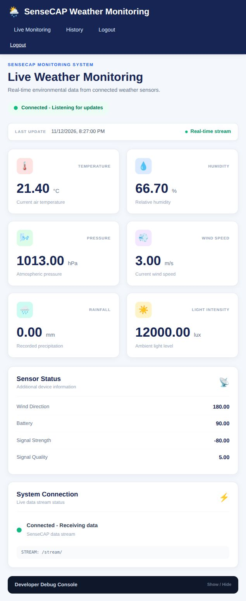
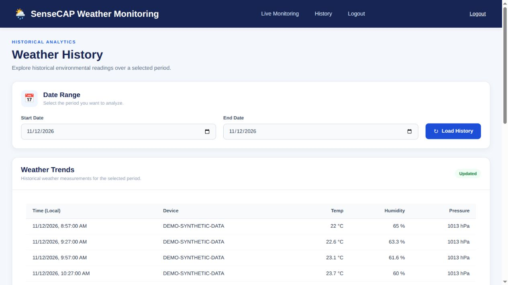

# SenseCAP Weather Dashboard

A Django weather-monitoring project with a browser dashboard, date-filtered historical readings and a server-sent events (SSE) stream. The repository includes MQTT ingestion code for The Things Network (TTN), Redis integration, Docker configuration and Gunicorn/gevent serving.

## What the project demonstrates

For a Junior Software Developer portfolio, the project shows Python/Django views and models, authenticated pages, data retrieval, browser updates through SSE, and service configuration. The frontend uses Django templates and vanilla JavaScript. Database configuration supports PostgreSQL via `DATABASE_URL`, with SQLite as the local fallback; the local review used SQLite.

The screenshots below demonstrate the dashboard and historical readings working locally with synthetic data. They do not establish a currently live deployment or connectivity to a physical sensor.

## Local demonstration — synthetic data

Captured on **12 November 2026** for a portfolio review supporting a Saolix Junior Software Developer application. All readings and device identifiers in these screenshots are synthetic. Redis, SQLite and the web server ran locally. No real sensor credentials or live TTN/MQTT connection were used.

### Dashboard — local demonstration using synthetic data

The existing SSE endpoint delivered the initial stored sample reading through Gunicorn/gevent, and the dashboard displayed weather values. Labels such as “Connected” and “Receiving data” refer to this local application stream; they are not evidence of real sensor connectivity. No application source changes were needed for this capture.



### Historical readings — local demonstration using synthetic data

Date-filtered retrieval populated the history table with synthetic records for `DEMO-SYNTHETIC-DATA`. This demonstrates the readings table, not chart rendering or the aggregate endpoint. The page's bottom summary has suspected field-label mismatches and is not verified as correct.



See [screenshot context and limitations](docs/screenshots/README.md).

## Implemented behavior and verification limits

- With local configuration, Django checks and migrations completed; login, authenticated dashboard, authenticated history and the historical readings API returned HTTP 200.
- The local SSE/dashboard capture and date-filtered history table worked using synthetic readings.
- Device-status requests failed in the review for both an empty database and a sample reading. The aggregate endpoint also failed because of datetime parsing. Those issues remain unresolved in this documentation change.
- Django's development server rejected the stream response's `Connection` header; Gunicorn/gevent successfully served the initial reading.
- PostgreSQL, hosted deployment, physical sensor connectivity, chart rendering and continuous sensor updates were not verified. The existing pytest suite was not run during the review.

## Local setup status

```bash
git clone https://github.com/Paulshapwala/Sensecap-dashboard.git
cd Sensecap-dashboard
```

This repository still needs setup improvements for a reproducible fresh-clone demo. The review installed `requirements.txt` in an isolated Python 3.12 environment, supplied a temporary `INVITE_KEY` and a loopback `REDIS_URL`, started local Redis, and used the SQLite fallback. Migrations and local authentication setup were required. The synthetic seed data and temporary demo setup are not shipped by this documentation change.

Relevant configuration includes:

| Setting | Purpose |
| --- | --- |
| `INVITE_KEY` | Required at startup; invite-only registration |
| `REDIS_URL` | Local Redis connection; supply explicitly for the stream services |
| `DATABASE_URL` | PostgreSQL connection when supplied; otherwise SQLite fallback |
| `SECRET_KEY`, `DEBUG`, `ALLOWED_HOSTS`, `CSRF_TRUSTED_ORIGINS` | Django security and host/origin configuration |
| `TTN_APP_ID`, `TTN_API_KEY`, `TTN_DEVICE_ID`, `TTN_BROKER`, `TTN_PORT` | MQTT integration configuration; no live connection was tested |

For a local synthetic-data review, invoke migrations and the web server separately rather than `start.sh`, which also starts the MQTT worker:

```bash
python -m pip install -r requirements.txt
# Set local environment values and start Redis before the following commands.
python manage.py migrate
python manage.py createsuperuser
gunicorn --worker-class gevent --worker-connections 1000 config.wsgi:application --bind 127.0.0.1:8000
```

An empty database will not reproduce the populated screenshots; sample-data seeding remains follow-up work. The Compose service is named `django_app` (for example, `docker compose exec django_app python manage.py migrate`). Its default startup invokes `start.sh` and the MQTT worker, so it is not yet a dedicated offline sample-data mode. Keep credentials private and use local values for demonstrations.

## Planned improvements

- Repair device-status empty-state handling and datetime conversions in device-status and aggregate responses.
- Verify and correct the history summary field mappings.
- Add documented environment examples, a synthetic seed command and an explicit offline demo mode.
- Validate continuous updates, charts, PostgreSQL and end-to-end MQTT ingestion separately before claiming those workflows are verified.

These are follow-up tasks; this change adds documentation and screenshots only.
